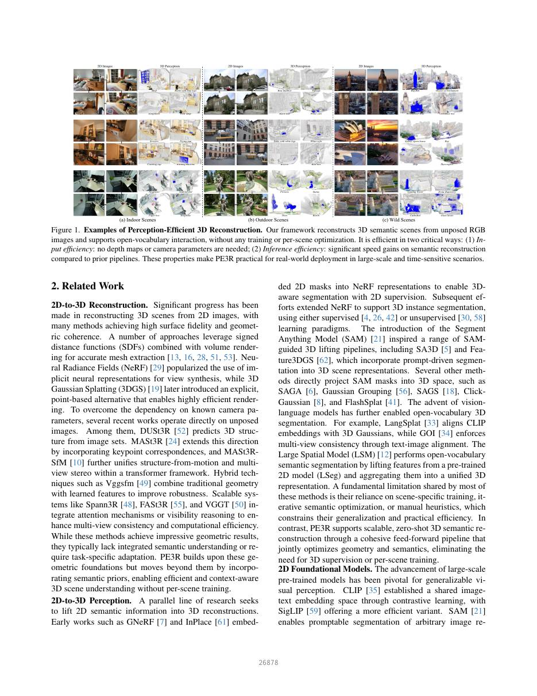
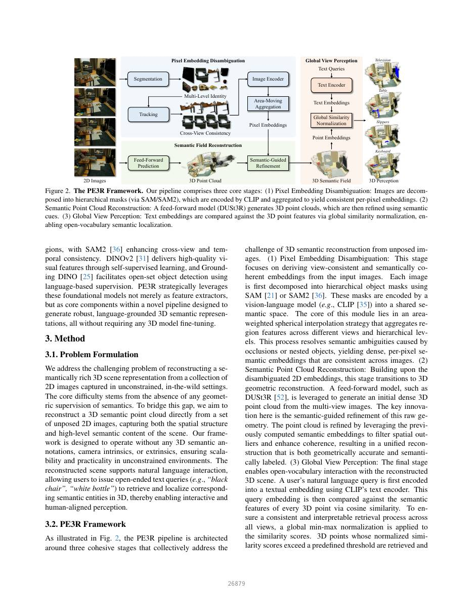
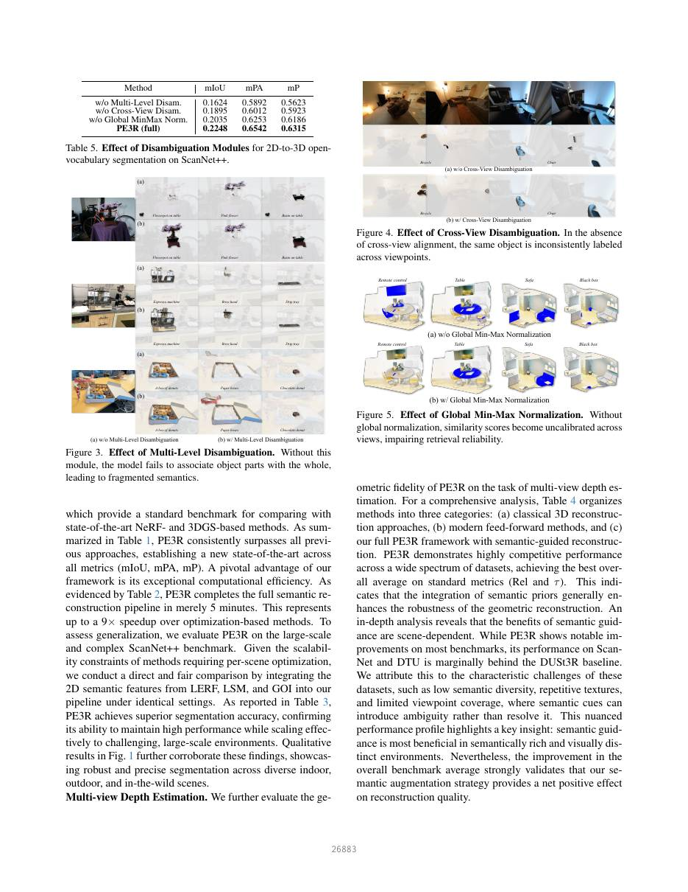
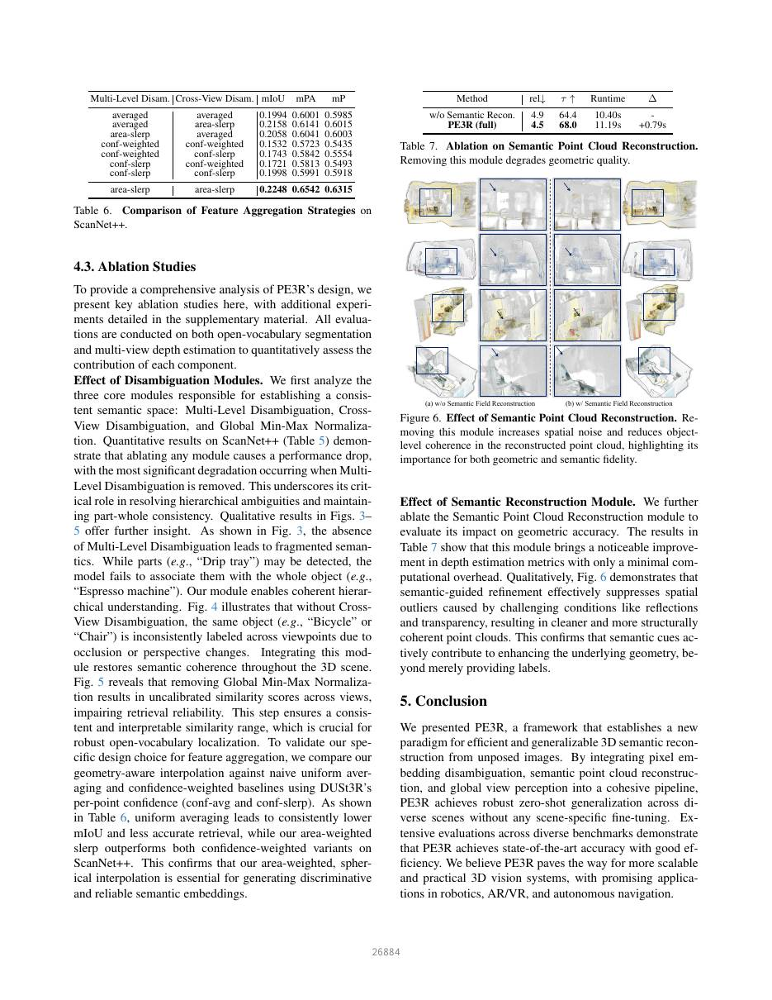

# PE3R: Perception-Efficient 3D Reconstruction — 中文全文译文

> 对应 CVPR 2026 正式主论文 11 页 + 官方补充材料 2 页；参考文献列表不翻译。原始论文及补充材料分别见 [paper.pdf](paper.pdf) 与 [supplement.pdf](supplement.pdf)。本译文为非官方中文翻译；译注与作者原文严格分开。

# PE3R 完整中文译文

版本：CVPR 2026 Open Access 正式主文 11 页（第 1–8 页正文与致谢、第 9–11 页参考文献），另附官方 2 页 Supplementary Material（第 6–7 节）。下文为除参考文献列表之外的中文翻译，公式、数据、图表编号保留；补充材料的原作者证明存在的特殊等式在译注中单独提示。

## 摘要（PDF 第1页）

近期的 2D-to-3D 感知进展已经能够从无位姿图像中恢复三维场景语义。然而，现有主流方法通常存在泛化能力有限、依赖逐场景优化，以及不同视角间语义不一致的问题。为解决这些限制，我们提出 PE3R：一种无需调参（tuning-free）、高效且可泛化的三维语义重建框架。PE3R 在前馈流水线中融合多视图几何与二维语义先验，不需要任何针对具体场景的微调，即可在不同场景和物体类别上实现零样本泛化。

在开放词汇分割和多视图深度估计上的大量评估表明，PE3R 不仅将推理速度最多提高 9 倍，而且在语义与几何指标上都建立了新的最佳结果。该方法为可扩展、语言驱动的三维场景理解铺平了道路。代码发布于 github.com/hujiecpp/PE3R。

## 1. 引言（PDF 第1页）

机器视觉在二维感知任务上已经取得显著成功，但人类感知本质上是三维的：人会无缝整合多个视角，形成对世界的一致理解 [2,43,54]。这一根本差距引出了计算机视觉中的核心问题：能否利用强大的二维感知模型，在不依赖三维监督的情况下重建并理解三维场景？这一问题包含两个方面：既要从无位姿图像中估计准确几何，也要把二维语义信息提升为一致的三维表示。

近年来的方法已经在 2D-to-3D 感知上取得很大进展，能够从无位姿多视图图像恢复几何与语义 [5,6,15,17,18,20,23,27,32,33,45-47,56,62]。然而，这些方法通常面临三难困境：难以跨场景泛化、无法保持跨视角语义一致性、计算开销高。例如，NeRF [29] 和 3D Gaussian Splatting（3DGS）[19] 可以生成高质量重建，但通常需要逐场景训练和沉重的语义提升过程，因此不适合实时或大规模应用。

为突破这些限制，我们提出 PE3R，一种高效、准确、可泛化的三维语义重建框架。受前馈几何估计 [24,50,52] 启发，PE3R 采用无需逐场景微调的前馈流水线，实现快速推理。如图1所示，框架包含三个精心设计的模块：（1）像素嵌入消歧，在视角之间及物体层级之间保持语义一致；（2）语义点云重建，把几何与稠密二维语义融合并细化三维结构；（3）全局视角感知，通过语言落地实现开放词汇物体检索。这一整体设计使模型能在未见环境上稳健地零样本泛化。

我们在多类基准上进行广泛评估：开放词汇分割使用 Mip-NeRF360 [3]、Replica [44] 与 ScanNet++ [57]；多视图深度估计使用 KITTI [14]、ScanNet [9]、DTU [1]、ETH3D [39] 与 Tanks and Temples [22]。结果表明，PE3R 的三维语义重建比既有方法最多快 9 倍，同时提升语义保真度和几何精度。

主要贡献如下：（1）提出快速、可扩展的 PE3R，直接处理无位姿二维图像，不需要三维监督、逐场景微调或相机参数；（2）提出三个模块，分别解决跨视角像素语义一致性、语义-几何融合与开放词汇交互；（3）在多个基准上验证最佳性能、零样本泛化与实际可扩展性，并公开代码以支持复现。

图1：PE3R 示例。框架从无位姿 RGB 图像重建三维语义场景并支持开放词汇交互，不需要训练或逐场景优化。它在输入端不需要深度图或相机参数，在推理端比既有语义重建流水线显著更快。

## 2. 相关工作（PDF 第2-3页）

### 2D-to-3D 重建

从二维图像重建三维场景已经取得显著进展，许多方法能获得高表面保真度和几何一致性。一类方法把符号距离函数（SDF）与体渲染结合以提取准确网格 [13,16,28,51,53]。NeRF [29] 推广了用于新视角合成的隐式神经表示，3DGS [19] 随后给出显式、点式表示并实现高效渲染。

为消除已知相机参数依赖，近期方法开始直接处理无位姿图像。DUSt3R [52] 从图像集合预测三维结构；MASt3R [24] 进一步加入关键点对应；MASt3R-SfM [10] 在 Transformer 框架内统一 SfM 与多视图立体视觉；Vggsfm [49] 等混合方法结合传统几何与学习特征以提高鲁棒性；Spann3R [48]、FASt3R [55] 和 VGGT [50] 使用注意力或可见性推理提高多视图一致性与效率。这些方法几何效果突出，但通常没有集成语义理解或需要任务适配。PE3R 在这些几何基础之上加入语义先验，不做逐场景训练即可实现高效、上下文感知的三维理解。

### 2D-to-3D 感知

另一条研究线把二维语义提升到三维重建中。GNeRF [7]、InPlace [61] 等早期方法把二维 mask 嵌入 NeRF，用二维监督实现三维分割；后续工作把 NeRF 扩展到三维实例分割，包括监督 [4,26,42] 与无监督 [30,58] 范式。

SAM [21] 推动了多种 SAM 引导的三维提升流水线，如 SA3D [5] 与 Feature3DGS [62]；它们将提示式分割并入三维场景表示。SAGA [6]、Gaussian Grouping [56]、SAGS [18]、Click-Gaussian [8] 与 FlashSplat [41] 直接把 SAM mask 投影到三维空间。视觉语言模型又进一步支持开放词汇三维分割：LangSplat [33] 将 CLIP 嵌入与三维高斯对齐；GOI [34] 通过图文对齐约束跨视角一致性；Large Spatial Model（LSM）[12] 把预训练二维模型 LSeg 的特征提升并聚合为统一三维表示。

这些方法普遍依赖场景特定训练、迭代语义优化或人工启发式规则，限制了泛化和实际效率。PE3R 通过统一的前馈流水线实现可扩展、零样本三维语义重建，联合处理几何和语义，不需要三维监督或逐场景训练。

### 二维基础模型

大规模预训练模型对可泛化视觉感知至关重要。CLIP [35] 通过对比学习建立共享图文嵌入空间，SigLIP [59] 提供更高效的变体；SAM [21] 支持对任意图像区域进行提示式分割，SAM2 [36] 增强跨视角和时序一致性；DINOv2 [31] 通过自监督学习高质量视觉特征，Grounding DINO [25] 用语言监督实现开放集检测。

PE3R 不只是把这些基础模型当作特征提取器，而是把它们作为新流水线的核心部件，生成稳健、语言落地的三维语义表示，同时不需要对任何三维模型进行微调。

## 3. 方法（PDF 第3-5页）

### 3.1 问题定义

本文研究如何从在无约束、真实环境中采集的一组二维图像，重建语义丰富的三维场景表示。核心困难是缺少任何语义几何监督。为弥合这一差距，目标是直接从无位姿二维图像集合重建三维语义点云，同时捕获场景空间结构和高层语义。

框架不需要三维语义标注、已知相机参数或逐场景优化。它通过前馈推理跨场景、类别与视角泛化。输入是 n 张 RGB 图像 X¹,...,Xⁿ∈R^{3×H×W}；输出是稠密三维点集合，每个点都有三维坐标和位于共享图文嵌入空间中的语义向量。该表示支持开放词汇语言查询，使用户能实时、通过语言定位物体与区域。

### 3.2 PE3R 框架

如图2，PE3R 通过三个阶段解决无位姿图像的三维语义重建。（1）像素嵌入消歧：每张图先由 SAM/SAM2 分解为层级物体 mask，再由 CLIP 等视觉语言模型编码到共享语义空间。面积加权球面插值跨视角、跨层级聚合区域特征，解决遮挡或嵌套物体造成的语义歧义，得到跨图像一致的稠密像素语义嵌入。

（2）语义点云重建：DUSt3R 等前馈模型从多视图图像生成初始稠密点云。核心改进是用前一步语义嵌入引导几何细化：过滤空间离群点、改善跨视角对齐。输出点云同时包含准确几何与语言对齐语义。

（3）全局视角感知：用户文本由语言编码器投影到同一嵌入空间，与三维点语义特征计算余弦相似度。全局归一化后，相关物体或区域可被精确定位，实现实时、语言落地的场景理解与探索。

图2：PE3R 流水线。第一阶段以 SAM/SAM2 产生层级 mask、以 CLIP 编码并聚合像素嵌入；第二阶段用 DUSt3R 产生并以语义细化点云；第三阶段把文本与三维点特征进行全局归一化相似度匹配。

### 3.3 像素嵌入消歧

跨多视角建立一致语义嵌入空间是稳健三维重建的基础，但存在两类歧义：（i）物体级歧义：重叠或嵌套结构（如桌上的杯子）使语义关联不确定；（ii）视角级歧义：遮挡或透视变化导致不同视角语义不一致。为解决这些问题，作者构造既能区分物体、又跨视角一致的稠密像素嵌入。“物体”被定义为一组具有层级关系且大量空间重叠的 mask；若较小 mask 与较大区域的 IoU 超过 0.9，则把小 mask 归入该大物体。这一简单启发式无需外部监督或预定义标签，即可把细粒度部件（如椅腿）与整体物体区域关联。

**图像嵌入提取。**给定 n 张 X¹,...,Xⁿ∈R^{3×H×W}，使用 SAM 与 SAM2 把每张图分解为具有跨视图一致物体索引的层级 mask，得到 M¹,...,Mⁿ∈R^{m×3×H×W}，m 为每图 mask 数量。视觉语言编码器 F\_img 将 masked region 编码到语义空间：

**(1)** F¹,F²,...,Fⁿ = N(F\_img(M¹,M²,...,Mⁿ))

其中 Fⁱ∈R^{m×d} 是第 i 张图的嵌入矩阵，N(·) 表示 L2 归一化。

**面积加权插值。**为了消解语义歧义并在视角、层级之间对齐特征，作者提出几何感知的聚合策略。可见面积较大的 mask 通常提供更稳定可靠的语义，应在聚合中具有更大影响。给定单位嵌入 F\_A、F\_B 及面积 area\_A、area\_B，令 t=area\_B/(area\_A+area\_B)，聚合为：

**(2)** F̂\_B = aF\_A+bF\_B，a=sin((1-t)θ)/sinθ，b=sin(tθ)/sinθ

θ 是 F\_A 与 F\_B 的夹角。该式有两项性质。命题1（向量归一化）：插值后的 F̂\_B 保持单位范数，因此仍处于原语义嵌入空间。命题2（语义引导）：若 F\_A 与参考语义 F\_C 的相似度高于 F\_B，则 F̂\_B 与 F\_C 的相似度也高于 F\_B，聚合结果会朝更有语义意义的方向移动。这保证插值既具几何合理性又具有语义信息。

**像素嵌入集成。**两阶段集成同时在视图内和视图间工作。（1）视图内：每图 mask 按面积降序处理；较小 mask（可能是部件）的嵌入以面积加权插值逐步并入较大 mask（可能是整体），促进单视图层级 part-whole 一致性。（2）跨视图：在首帧使用 SAM segment-everything mask 初始化 SAM2；后续视图由 SAM2 传播已跟踪 mask，同时 SAM 重新提出全部 mask。若新 SAM mask 与所有现有 SAM2 mask 的 IoU 都小于 0.1，则视为新发现/重新检测的实例，加入追踪提示，在大视角变化或跟踪丢失时提高召回。关联不可靠时跳过跨视图融合，退回视图内消歧。

最终得到跨空间层级和多视角均稳定、语义一致的物体嵌入。再把物体嵌入投影回像素空间，得到 E¹,...,Eⁿ∈R^{H×W×d} 的稠密像素语义图。

### 3.4 语义点云重建

在消歧后的像素嵌入基础上，本模块重建高质量三维语义点云。作者使用 DUSt3R 等前馈点图预测器，从多视图图像直接估计逐像素三维坐标：

**(3)** P¹,P²,...,Pⁿ = F\_pts(X¹,X²,...,Xⁿ)

每个 Pⁱ∈R^{H×W×3} 给出第 i 个视角每个像素的三维坐标 (x,y,z)。前馈范式虽快，但遮挡、反射、透明表面等视觉伪影会污染初始点图。作者用一致语义嵌入引导细化，以同时约束几何与语义一致性。

**异常点检测。**基本假设是：属于同一语义区域的像素在三维空间中应形成空间一致的簇。对每个像素 P\_{i,j}，在 k×k 邻域内只对语义标签相同的像素计算平均欧氏距离：

**(4)** L\_{i,j}= Σ\_{dx,dy} I(M\_{i,j},M\_{i+dx,j+dy})·D(P\_{i,j},P\_{i+dx,j+dy}) / Σ\_{dx,dy} I(M\_{i,j},M\_{i+dx,j+dy})

其中 dx,dy∈[-⌊k/2⌋,⌊k/2⌋]；I=1 表示两个像素具有相同实例追踪索引，D 是三维欧氏距离。每个视角得到 Lⁱ∈R^{H×W} 的语义感知距离图。归一化后超过预设阈值的像素标为空间异常并排除，从而产生更干净的中间点云。

**语义引导细化。**仅过滤离群点并不能主动修正底层错误估计。与昂贵的事后几何正则化（如最小二乘拟合）不同，作者在图像空间处理根因：对于每个异常点，将其 RGB 值 y 与周围语义区域平均颜色 x 融合：

**(5)** ŷ = α·x + (1-α)·y，α∈[0,1]

α 控制语义平滑强度；它抑制会误导几何预测器的纹理噪声，同时尽量保留真实结构边缘。平滑图像再次送入 F\_pts，得到空间更一致、与场景语义结构更对齐的三维估计。最后全局对齐把全部细化点图 P̂ⁱ 同步到统一坐标系。输出为融合的语义点云，每个点均有三维坐标和对应语义嵌入。

### 3.5 全局视角感知

最后阶段使用统一语义点云支持直观的开放词汇交互。用户文本先由语言编码器 F\_txt（如 CLIP）得到嵌入：

**(6)** T = F\_txt(text)，T∈R^d

再计算 T 与所有视角稠密像素嵌入 E¹,...,Eⁿ 的余弦相似度：

**(7)** [S¹,S²,...,Sⁿ] = D(T,[E¹,E²,...,Eⁿ])

D 为余弦相似度。为保证不同视角检索分数一致，把所有视角相似度拼接并做全局 min-max 归一化到 [0,1]。这产生统一、可解释且不受视角特定变化影响的尺度。对归一化结果使用预设阈值，从相应细化点图中选择三维点；超过阈值的点视为与文本语义对齐并保留用于三维定位。由此可用自然语言与重建场景交互，不需要预定义类别或重新训练。

## 4. 实验（PDF 第6-8页）

### 4.1 实验细节

**数据集与任务。**评估包含开放词汇 2D-to-3D 分割和多视图深度估计。开放词汇分割使用 Mip-NeRF360、Replica 和 ScanNet++：前两者是较紧凑、物体中心场景，标签沿用 GOI；ScanNet++ 检验大型复杂室内场景中的泛化。

多视图深度估计使用 KITTI（室外驾驶）、ScanNet（室内）、DTU（受控物体扫描）、ETH3D（高分辨率场景）、Tanks and Temples（大型室外），覆盖室内与室外环境。

**实现细节。**PE3R 使用 MobileSAMv2 高效分割、SAM2 获得时序一致 mask 轨迹，DUSt3R 作为核心前馈三维点图预测器。每图用 SAM segment-everything mask，SAM2 负责实例跟踪：首图 SAM mask 初始化 SAM2；后续图先由 SAM2 传播 mask，再由 SAM 重新检测全部对象。若某个 SAM mask 与所有 SAM2 mask 的 IoU 均小于 0.1，则作为新发现/重检测实例加入 tracker，以恢复大视角变化下丢失的轨迹。全部实验在单台 NVIDIA A100 GPU 与 Intel i7 CPU 服务器上完成。

**评估协议。**开放词汇分割使用 mIoU、mean Pixel Accuracy（mPA）与 mean Precision（mP）。Mip-NeRF360 和 Replica 遵循 GOI 协议：先构建整场三维语义表示，再执行 GOI 标注的开放词汇查询，把三维分割反投影到原二维图像与真值 mask 比较。

ScanNet++ 为降低计算量按连续四帧 snippet 处理，这是大型场景三维方法的常见做法。为公平比较，把 LERF、LSM、GOI 的语义嵌入直接替换进 PE3R 流水线，同时固定几何 backbone 和评估流程，使差异只来自像素级语义嵌入。最终三维分割仍投影回二维与真值比较。报告预处理与推理总时间。

多视图深度严格遵循 RobustMVD 官方协议：每个测试样本用 quasi-optimal 策略选择源视图；指标为 Absolute Relative Error（Rel，越低越好）和阈值 1.03 的 Inlier Ratio（τ，越高越好），分别报告各数据集和平均值。

### 4.2 主要结果

**开放词汇分割。**表1显示 PE3R 在 Mip-NeRF360 和 Replica 的 mIoU、mPA、mP 上均超过此前方法。表2显示完整三维语义重建仅需 5 分钟，相比需要逐场景优化的方法最多加速 9 倍。大型 ScanNet++ 上，在相同几何与评估设置中替换不同二维嵌入，PE3R 嵌入仍取得最佳分割准确率。图1的定性结果显示模型在室内、室外和野外场景中均能稳健精确分割。

表1：小规模 Mip-NeRF360 / Replica 开放词汇分割

| 数据集 | 方法 | mIoU | mPA | mP |
| Mip | LERF / F-3DGS / GS Grouping / LangSplat / OpenNeRF / LSM / GOI / PE3R | 0.2698 / 0.3889 / 0.4410 / 0.5545 / 0.5734 / 0.6254 / 0.8646 / **0.8951** | 0.8183 / 0.8279 / 0.7586 / 0.8071 / 0.8345 / 0.8887 / 0.9569 / **0.9617** | 0.6553 / 0.7085 / 0.7611 / 0.8600 / 0.8959 / 0.9192 / 0.9362 / **0.9726** |
| Replica | 同序 | 0.2815 / 0.4480 / 0.4170 / 0.4703 / 0.5014 / 0.5614 / 0.6169 / **0.6531** | 0.7071 / 0.7901 / 0.7370 / 0.7694 / 0.7915 / 0.8113 / 0.8367 / **0.8377** | 0.6602 / 0.7310 / 0.7276 / 0.7604 / 0.7831 / 0.7961 / 0.8088 / **0.8444** |

表2：Mip-NeRF360 三维语义重建耗时

| 方法 | 预处理 | 训练 | 总时间 |
| LERF | 3 min | 40 min | 43 min |
| F-3DGS | 25 | 623 | 648 |
| GS Grouping | 27 | 138 | 165 |
| LangSplat | 50 | 99 | 149 |
| GOI | 8 | 37 | 45 |
| PE3R | 5 | - | **5** |

表3：ScanNet++ 不同嵌入

| 嵌入 | mIoU | mPA | mP |
| LERF | 0.1824 | 0.6024 | 0.5873 |
| GOI | 0.2101 | 0.6216 | 0.6013 |
| LSM | 0.2124 | 0.6346 | 0.6114 |
| PE3R | **0.2248** | **0.6542** | **0.6315** |

**多视图深度。**表4把方法分为经典重建、现代前馈方法、带语义重建三类。PE3R 在广泛数据集上具有竞争力，并取得 Rel 与 τ 的最佳平均值，说明语义先验总体提高几何鲁棒性。但收益依赖场景：在多数基准上改进明显，在 ScanNet 与 DTU 上略落后于 DUSt3R；作者归因于低语义多样性、重复纹理与有限视角覆盖，此时语义线索可能引入而非消除歧义。总体平均仍说明语义增强净收益为正。

表4：RobustMVD 多视图深度（Rel↓ / τ↑）

| 方法 | KITTI | ScanNet | ETH3D | DTU | T&T | 平均 |
| DUSt3R 官方 | 9.1/39.5 | 4.9/60.2 | 2.9/76.9 | 3.5/69.3 | 3.2/76.7 | 4.7/64.5 |
| VGGT | 9.4/41.3 | 4.4/65.0 | 1.8/86.3 | 1.1/94.3 | 2.1/85.2 | 3.8/74.4 |
| PE3R+DUSt3R | 9.4/48.6 | 5.5/55.1 | 2.3/82.0 | 3.2/69.1 | 2.1/85.3 | 4.5/68.0 |
| PE3R+VGGT | 9.2/43.8 | 4.3/65.8 | 1.7/86.6 | 1.1/94.4 | 2.0/85.4 | **3.7/75.2** |

### 4.3 消融实验

作者同时在开放词汇分割和多视图深度上分析各模块。表5消融多层级消歧、跨视图消歧和全局 min-max 归一化；删除任一模块都会下降，删除多层级消歧下降最大，说明层级歧义和 part-whole 一致性尤为关键。

图3中，无多层级消歧时虽然能识别“滴水盘”等部件，却无法与“浓缩咖啡机”整体关联，语义碎片化。图4显示无跨视图消歧时，同一自行车或椅子在不同视角获得不一致标签；加入模块后恢复一致。图5显示无全局 min-max 归一化时，不同视角相似度尺度失准，检索不可靠。

表5：ScanNet++ 消歧模块

| 设置 | mIoU | mPA | mP |
| 无多层级消歧 | 0.1624 | 0.5892 | 0.5623 |
| 无跨视图消歧 | 0.1895 | 0.6012 | 0.5923 |
| 无全局归一化 | 0.2035 | 0.6253 | 0.6186 |
| 完整 PE3R | **0.2248** | **0.6542** | **0.6315** |

表6把面积加权 slerp 与均匀平均、基于 DUSt3R 点置信度的平均/球面插值比较。均匀平均 consistently 更低；面积加权 slerp 在 ScanNet++ 上优于所有置信度加权变体，说明可见面积比几何置信度更适合生成判别性、可靠的语义嵌入。

表6：ScanNet++ 特征聚合策略

| 多层级 / 跨视图 | mIoU | mPA | mP |
| average / average | 0.1994 | 0.6001 | 0.5985 |
| average / area-slerp | 0.2158 | 0.6141 | 0.6015 |
| area-slerp / average | 0.2058 | 0.6041 | 0.6003 |
| conf-weighted / conf-weighted | 0.1532 | 0.5723 | 0.5435 |
| conf-weighted / conf-slerp | 0.1743 | 0.5842 | 0.5554 |
| conf-slerp / conf-weighted | 0.1721 | 0.5813 | 0.5493 |
| conf-slerp / conf-slerp | 0.1998 | 0.5991 | 0.5918 |
| area-slerp / area-slerp | **0.2248** | **0.6542** | **0.6315** |

表7消融语义点云重建：去掉模块时平均 Rel/τ 为 4.9/64.4，运行 10.40s；完整模型为 4.5/68.0，运行 11.19s，只增加 0.79s。图6显示语义引导细化能抑制反射、透明等条件造成的离群点，产生更干净、更结构一致的点云，说明语义不仅提供标签，也确实改善几何。

表7：语义点云重建消融

| 方法 | Rel↓ | τ↑ | 时间 | 增量 |
| 无语义重建 | 4.9 | 64.4 | 10.40s | - |
| 完整 PE3R | 4.5 | 68.0 | 11.19s | +0.79s |

图 3：多层级消歧的作用。移除此模块会使模型无法正确关联物体部件与整体，从而造成语义碎片化。

图 4：跨视角消歧的作用。缺少跨视角对齐时，同一物体在不同视角下会被赋予不一致的标签。

图 5：全局最小-最大归一化的作用。缺少全局归一化时，不同视角间的相似度分数无法得到统一标定，从而降低检索可靠性。

图 6：语义点云重建模块的作用。移除此模块会增加空间噪声并降低重建点云在物体层面的一致性，体现它对几何和语义保真度的作用。

## 5. 结论（PDF 第8页）

本文提出 PE3R，为无位姿图像的高效、可泛化三维语义重建建立了新范式。通过把像素嵌入消歧、语义点云重建与全局视角感知统一到一个流水线中，PE3R 不需要任何逐场景微调，即可跨不同场景稳健零样本泛化。多类基准上的广泛实验表明，PE3R 以良好效率取得最佳准确率。作者认为它将推动更可扩展、更实用的三维视觉系统，并可用于机器人、AR/VR 和自主导航。

**致谢。**本项目由新加坡国家研究基金会资助，属于先进机器人技术创新中型研究中心项目。

## 官方补充材料（CVPR 2026，另附 2 页 PDF）

以下为与主论文分开发布的官方补充材料完整中文译文，按照原文第 6、7 节及表 8–11、公式（8）–（17）的编号编排。官方原文：<supplement.pdf>，逐页图像见 [补充材料第 1 页](supplement-pages/page-01.jpg)和[第 2 页](supplement-pages/page-02.jpg)。补充材料不包含参考文献表。

## 6. 插值性质证明（Proof of Interpolation Properties）

本节给出本文面积加权插值策略两个关键性质的完整证明。这两个性质支撑主论文第 3.3 节所述的像素嵌入消歧（Pixel Embedding Disambiguation）方法。

### 命题 1：向量归一化（Vector Normalization）

插值后的向量 \hat F\_B 保持单位范数，因此仍位于原有语义嵌入空间之内。

**证明。**插值向量的范数表示为：

$$\|\hat{F}\_B\|\_2=\|aF\_A+bF\_B\|\_2.\tag{8}$$

展开后得到：

$$\|\hat{F}\_B\|\_2^2=(aF\_A+bF\_B)\cdot(aF\_A+bF\_B)=a^2\|F\_A\|\_2^2+2ab F\_A\cdot F\_B+b^2\|F\_B\|\_2^2.\tag{9}$$

由于 F\_A 与 F\_B 为单位向量，有：

$$\|F\_A\|\_2=1,\quad\|F\_B\|\_2=1,\quad F\_A\cdot F\_B=\cos\theta.\tag{10}$$

将这些值代入，可得：

$$\|\hat F\_B\|\_2^2=\frac{\sin^2((1-t)\theta)+\sin^2(t\theta)+2\sin((1-t)\theta)\sin(t\theta)\cos\theta}{\sin^2\theta}.\tag{11}$$

运用三角恒等式：

$$\sin^2\theta=\sin^2((1-t)\theta)+\sin^2(t\theta)+2\sin((1-t)\theta)\sin(t\theta)\cos\theta,\tag{12}$$

得到：

$$\|\hat F\_B\|\_2^2=\frac{\sin^2\theta}{\sin^2\theta}=1.\tag{13}$$

因此证实 \hat F\_B 是单位向量，命题得证。

### 命题 2：语义引导（Semantic Guidance）

如果 F\_A 与参考语义向量 F\_C 的相似度高于 F\_B 与 F\_C 的相似度，那么插值后的 \hat F\_B 与 F\_C 的相似度也将高于原来的 F\_B。这会引导聚合表示朝更有语义意义的方向移动。

**证明。**\hat F\_B 与 F\_C 之间的余弦相似度为：

$$\hat F\_B\cdot F\_C=a(F\_A\cdot F\_C)+b(F\_B\cdot F\_C).\tag{14}$$

由于 F\_A·F\_C 大于 F\_B·F\_C，因此：

$$a(F\_A\cdot F\_C)+b(F\_B\cdot F\_C)>(a+b)(F\_B\cdot F\_C).\tag{15}$$

原文随后使用三角函数性质写出：

$$a+b=\frac{\sin((1-t)\theta)}{\sin\theta}+\frac{\sin(t\theta)}{\sin\theta}=1,\tag{16}$$

并得出：

$$\hat F\_B\cdot F\_C=a(F\_A\cdot F\_C)+b(F\_B\cdot F\_C)>F\_B\cdot F\_C.\tag{17}$$

作者由此认为，\hat F\_B 在语义上融合了来自 F\_A 与 F\_B 的信息，使聚合表示趋向更具语义意义的方向，命题得证。

**译注（与作者原文分开）：**式（16）中的等号按官方补充材料保留。一般的球面线性插值权重之和未必等于 1（例如 t=0.5 且 θ 非零时），因此这里的证明步骤有待独立核查；不应把该等号当成已严格成立的普遍恒等式。此处不擅自修改作者公式。

## 7. 扩展消融实验（Extended Ablation Studies）

本节给出对主论文第 4.3 节分析的补充消融实验，进一步展示 PE3R 设计选择和参数敏感性的影响。

### 7.1 异常点选择（Anomaly Point Selection）

作者通过经验与理论两方面的分析验证异常点检测机制的准确性。

**经验验证。**对跨语义区域中空间一致点之间的平均三维距离进行统计分析，以确定异常点阈值。该阈值能够有效区分正常点与异常点。表 8 给出了 ScanNet 上不同阈值的结果，阈值 0.003 时性能最佳。

表 8：ScanNet 上不同异常点选择阈值的结果；主实验默认采用 0.003。

| 阈值 | rel ↓ | τ ↑ |
| --- | --- | --- |
| 0.001 | 6.1 | 49.3 |
| 0.002 | 5.9 | 50.3 |
| **0.003** | **5.5** | **55.1** |
| 0.004 | 5.6 | 53.6 |
| 0.005 | 5.8 | 52.8 |

**理论验证。**理论上，异常检测也可以通过对物体内部点的分布进行参数化建模来完成，例如高斯估计或最小二乘拟合。不过，对于复杂的大规模场景，此类方法的计算开销可能高到难以承受。作者采用的经验阈值策略是一种实用、可扩展的替代方案，在不显著增加计算负担的情况下保持良好性能。

### 7.2 滑动窗口大小分析（Sliding Window Size Analysis）

在局部语义感知距离计算中，滑动窗口的大小会明显影响重建质量和计算效率。如表 9 所示，作者在多视图深度估计任务中评估了三种窗口尺寸。5×5 窗口取得最佳折中：它包含足够的局部上下文，有助于稳健地检测异常点，又不会引入过多计算开销，也不会过度平滑精细几何细节。

表 9：不同滑动窗口尺寸对所有深度估计基准上异常点检测性能的影响。

| 窗口尺寸 | 平均 rel ↓ | 平均 τ ↑ |
| --- | --- | --- |
| 3×3 | 4.9 | 65.5 |
| **5×5** | **4.5** | **68.0** |
| 7×7 | 4.8 | 66.1 |

### 7.3 RGB 图像平滑分析（RGB Image Smoothing Analysis）

为提高模型在反射、透明物体和复杂纹理等困难区域中的稳健性，作者在估计点图之前对输入图像应用语义感知平滑。平滑操作为 \hat y = α·x + (1−α)·y，其中 x 表示语义区域的平均 RGB 值，y 为原始像素值，α 控制平滑强度。

表 10 显示，适度平滑（α=0.1）在抑制噪声和保留细节之间取得最佳平衡。更低的平滑系数（α 小于 0.1）无法充分处理视觉伪影，而更高的系数（α 大于 0.2）会过度平滑真实结构细节，最终降低几何精度。

表 10：语义感知平滑参数的影响。0.1 为最优；表头 a、b 表示语义区域均色与原 RGB 的混合权重。

| a (α) | b (1−α) | 平均 rel ↓ | 平均 τ ↑ |
| --- | --- | --- | --- |
| 0.00 | 1.00 | 5.3 | 60.2 |
| **0.10** | **0.90** | **4.5** | **68.0** |
| 0.20 | 0.80 | 4.7 | 62.3 |
| 0.50 | 0.50 | 4.9 | 61.6 |
| 0.80 | 0.20 | 6.1 | 59.4 |
| 0.90 | 0.10 | 6.5 | 57.5 |
| 1.00 | 0.00 | 10.2 | 50.2 |

### 7.4 迭代细化分析（Iterative Refinement Analysis）

作者进一步研究了在语义点云重建模块中反复执行细化的效果。如表 11 所示，单次细化已经带来明显提升；再增加迭代次数，改善幅度递减，而计算开销上升。这意味着该方法只需一轮处理就能完成有效的细化，从而保持整个前馈流水线的效率优势。

表 11：在 Mip-NeRF360 上不同迭代细化次数的重建性能；一次细化最优。

| 迭代次数 | 平均 rel ↓ | 平均 τ ↑ |
| --- | --- | --- |
| **1** | **4.5** | **68.0** |
| 2 | 4.6 | 67.9 |
| 3 | 4.6 | 67.9 |
| 4 | 4.6 | 67.9 |
