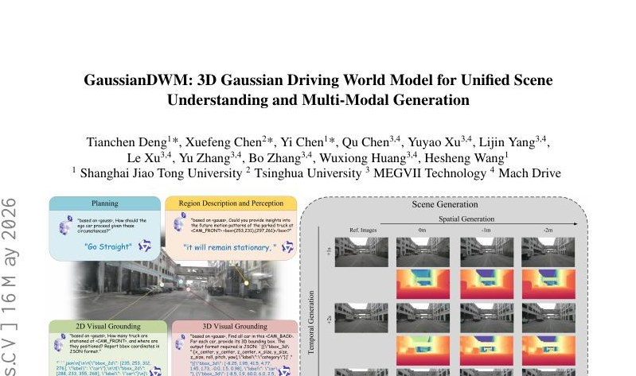
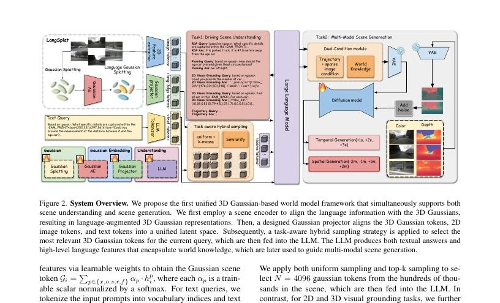
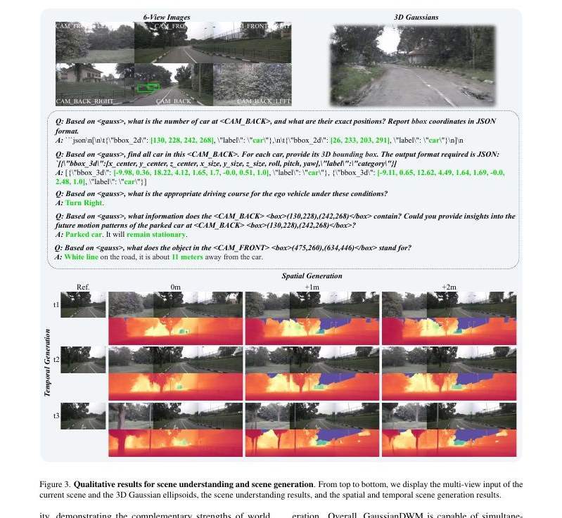
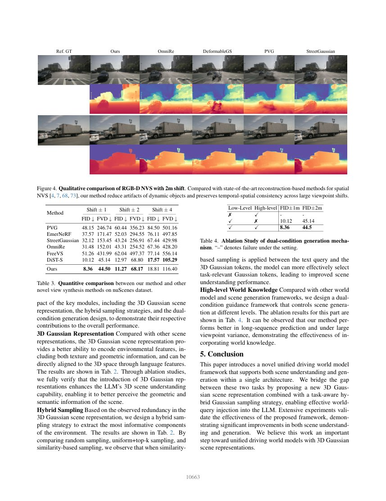
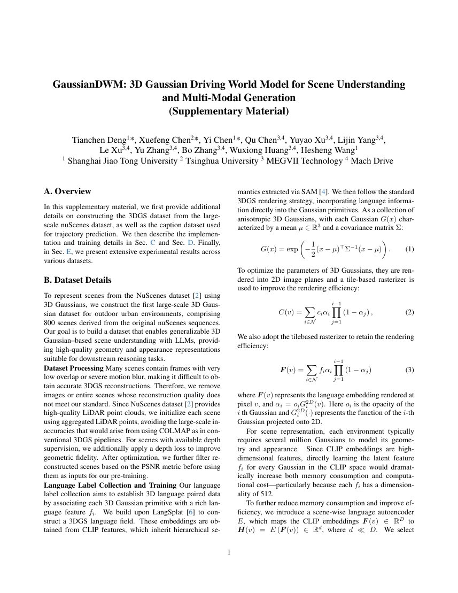

# GaussianDWM — 译文（从原有 HTML 等内容转换）

## 章节覆盖清单与版本说明

本译文对应 **GaussianDWM: 3D Gaussian Driving World Model for Unified Scene Understanding and Multi-Modal Generation**，arXiv:2512.23180v3（2026-05-16），并合并 CVPR 2026 官方补充材料。主论文 12 页、补充材料 7 页，共 19 页。参考文献列表不翻译；正文引用编号保持原样。

| 主论文 | 补充材料 |
| --- | --- |
| 摘要；1 引言；2 相关工作；3 方法（3.1–3.3）；4 实验（4.1–4.5）；5 结论 | A 概览；B 数据集细节；C 实现细节；D 消融实验；E 扩展实验 |

**完整性状态：repairing（未完成）。** 目前尚未达到完整逐段翻译验收：主论文方法、引言、相关工作和实验主体已补充，附录 A–E 已扩展，但主文表 1 的专用检测器合并单元格、个别补充表/图标签和轨迹坐标仍需对照原 PDF 核验，译文与网页视觉/离线公式也尚未完成独立验收。详见覆盖清单。 [覆盖清单](coverage.md)。

## 摘要

随着生成模型取得进展，驾驶世界模型（Driving World Model，DWM）快速发展。然而，现有 DWM 缺乏三维场景理解能力：它们只能依据输入数据条件生成内容，无法解释或推理驾驶环境。此外，现有方法多用点云或 BEV 特征表征三维空间，不能将文本信息准确对齐到其底层三维场景。

为解决这些局限，本文提出基于三维 Gaussian 场景表示的统一 DWM 框架，同时支持三维场景理解和多模态场景生成，并为两类任务提供更丰富的上下文信息。方法直接把语言特征嵌入每个 Gaussian 基元，从而将文本信息与三维场景对应起来，在早期实现模态对齐。

此外，本文设计任务感知、语言引导的采样策略，去除冗余三维 Gaussian，将准确而紧凑的三维 token 注入大语言模型。还设计了双条件多模态生成模型，将视觉语言模型提取的信息作为高层语言条件，并结合低层图像条件，共同指导多模态生成。

作者在 nuScenes 和 NuInteract 数据集上进行了广泛实验，验证所提框架的有效性。作者报告方法达到了最先进的性能，并计划在 GitHub 上公开代码。



图 1：本文提出首个基于三维 Gaussian 的统一世界模型框架，面向驾驶场景同时完成全面的理解与生成。该框架高效编码复杂场景、采样与任务有关的信息，并处理多种问答任务；利用提取的世界知识，进一步指导生成模型准确完成空间与时间方向的场景生成。

## 1. 引言

驾驶世界模型（Driving World Model，DWM）[20,28,61,3,63] 因为能够预测未来场景而成为自动驾驶中的重要组成部分。这类模型预测环境的变化并合成仿真数据，可用于风险预判、路线优化以及特殊场景（corner case）训练。

现有大多数方法通过预测图像 [76,70] 或点云 [73,36,38] 等模态实现上述目标，借此表达环境的视觉与几何性质。虽然这类 DWM 擅长预测环境将如何变化，但它们难以被解释、描述或查询，也难以便捷地提供视觉问答和场景描述等上下文信息。

随着大语言模型和视觉语言模型（Vision-Language Model，VLM）[69,57,58,81,60,59] 的迅速发展，研究者利用世界知识与因果推理在通用视觉任务中取得显著进步。这说明将 VLM 的场景理解能力与 DWM 的生成能力结合，是值得探索的方向。

值得注意的是，HERMES [80] 和 UniFuture [37] 等早期工作已经尝试将自动驾驶世界模型的理解与生成统一起来。它们以鸟瞰图（BEV）或深度特征表示空间信息，将这些特征与文本空间对齐，再送入生成模型。然而，这类 BEV 场景表示主要在特征层面进行文本与空间输入的对齐，准确度仍然不足。为解决这一局限，作者提出以 3DGS 为基础的场景表示，以统一场景理解与生成。

首先，作者直接在三维 Gaussian 中嵌入语言特征，实现文本与三维场景的显式空间对齐，从而改善跨模态对齐的准确性。其次，Gaussian 表示存在很高的冗余度——每个场景包含数万个 token，因此难以让 VLM 有效处理全部内容。对此，本文提出任务感知、语言引导的采样策略。

具体而言，方法计算输入文本与 3D Gaussian 的相似度，选择最符合当前查询的 Gaussian，并通过投影器将其映射到上下文空间，以精确而紧凑的三维 token 注入语言理解。最后，作者设计双条件多模态生成模型：理解分支产生的世界知识作为高层语言条件，图像特征提供低层图像条件。二者共同引导 RGB、深度和语言等多种模态的生成，并同时支持空间与时间方向的生成。

本文贡献归纳如下：

- 提出首个基于 3D Gaussian 的统一世界模型框架，同时支持场景理解与场景生成。
- 针对 3D Gaussian 场景表示，提出 token 提取与投影模块；面对 3D Gaussian 的冗余性，进一步设计任务感知语言引导采样策略，在克服上下文长度限制的同时保留关键空间信息。
- 设计双条件多模态场景生成框架：将高层世界知识特征与低层图像特征组合，以指导场景生成。
- 在 nuScenes 与 NuInteract 上开展扩展实验，说明该方法缩小了理解与生成之间的差距，既能准确理解场景，又能对未来场景进行更连贯的预测。

## 2. 相关工作

### 城市场景的新视角合成

随着 NeRF [44] 与三维 Gaussian Splatting（3DGS）[30] 的出现，许多研究将它们用于机器人建图与定位 [11,9,10,14,16,15]、虚拟现实（VR）[13,34,23,83,22,21] 和自动驾驶 [45,4] 等任务。早期基于 NeRF 的 NSG [45]、SUDS [53]、ProSGNeRF [12]、EmerNeRF [72] 和 FreeDriveRF [62] 等方法，通过场景图、光流及其他运动线索实现动态与静态场景成分的解耦重建。

近来出现的一系列基于 3DGS 的方法进一步提升了渲染效率。PVG [5] 引入基于周期振动的时间动力学表示，不依赖人工标注即可统一静态和动态元素。Street Gaussians [68]、Driving Gaussian [79] 与 DeSiRe-GS [48] 则显式区分动态和静态部分进行重建。

LESSON [47] 使用教师模型引导的扩散策略，仅借助二维监督生成 3D Gaussian splats；STORM [71] 使用前馈 Transformer 推断动态 Gaussian 及其速度，以提高大规模室外场景重建的效率；DrivingForward [51] 使用自监督位姿和深度估计，从稀疏环视输入进行前馈重建。MUDG [84] 和 Dist-4D [24] 则提出同时生成 RGB 和深度模态的多模态新视角合成框架。

### 驾驶世界模型

驾驶世界模型 [32,67,52,40,18] 因为能够提供完整环境表示并预测未来场景而受到广泛关注。目前的方法主要利用二维和三维条件进行场景生成。GAIA-1 [29] 使用自回归模型生成驾驶视频；DriveDreamer [76] 以三维结构为条件进行场景生成，从而提供有利于下游驾驶任务的几何表示。

MagicDrive [19] 使用跨视角注意力，并以相机位姿、道路地图等精确三维控制信号为条件，合成街景图像，进而改善三维目标检测与 BEV 分割。DreamDrive [43] 将视频扩散与混合 Gaussian 场景表示结合，通过具有三维一致性的动态视频渲染合成四维场景。最近，UniScene [33] 提出以 occupancy 为中心的统一语义、视觉和 LiDAR 数据生成方法。不过，现有 DWM 普遍忽略了对驾驶环境的场景理解能力。

### 用于驾驶的大语言模型

大语言模型（LLM）在场景理解 [56,27,78,75,82]、视觉问答（VQA）、二维和三维视觉定位等多种任务上表现出较强的泛化能力与丰富的世界知识。DriveGPT4 [66] 处理前视视频输入，预测车辆动作，并通过 LLM 给出自然语言解释。DriveLM [50] 则利用 LLM 进行图结构 VQA 和端到端自动驾驶。

NuInteract [77] 在大规模视觉语言模型（LVLM）中加入采用可学习查询集合的空间处理器，并在包含超过 150 万对多视图图像—语言样本的 NuInteract 数据集上训练；数据覆盖密集场景描述与多种交互任务。GaussianVLM [26] 提出基于三维 Gaussian 的视觉问答框架，使用类似 SceneSplat 的变分自动编码器（VAE）直接编码 3D Gaussian 场景。

与本文最密切相关的是 Hermes [80]：它以 BEV 为基础构建世界模型，将场景表示与 VLM 结合，用于联合理解和生成。然而，上述方法大多依赖图像、点云或 BEV 表示。相比之下，本文使用三维 Gaussian 场景表示 [8]，能够显式对齐语言特征与三维几何，因此可以更准确地联系不同模态，并更好地表达复杂环境中的纹理和结构信息。


## 3. 方法

本文提出 GaussianDWM：一个面向驾驶场景理解和生成、以三维 Gaussian 场景表示为基础的统一框架。图 2 给出了方法流程。输入由图像集合 {Iᵢ}、Gaussian 椭球集合 {Gᵢ} 和查询文本集合 {tᵢ} 组成。整个系统依次包含世界 Tokenizer（3.1）、场景理解（3.2）和多模态场景生成（3.3）三个模块。以下分别说明各模块的处理过程。



图 2：系统总览。场景编码器首先把语言信息对齐到 3D Gaussian，形成带语言特征的三维表示；Gaussian 投影器将三维 Gaussian token、二维图像 token 和文本 token 对齐到统一潜空间。随后，任务感知混合采样提取最符合当前查询的三维 token 并交给 LLM；LLM 同时输出文本回答和包含世界知识的高层语言特征，供多模态场景生成使用。

### 3.1 世界 Tokenizer

世界 Tokenizer 将当前多视图图像所描述的世界观测编码为紧凑、连续的 3D Gaussian 表示；之后再由 Gaussian 投影器把选定的三维特征映射到文本空间，以供 VLM 处理。该模块分为 3D Gaussian Tokenizer 和 3D Gaussian Projector 两部分。

3D Gaussian Tokenizer。为同时保留纹理、三维结构以及与语言的对应关系，作者选择 3D Gaussian 作为进入 LLM 的场景表示。在 LangSplat [49] 基础上构建 3DGS 语言场：每个 Gaussian 携带语言嵌入 fᵢ，语言嵌入来自 CLIP 特征，并包含 SAM [31] 提取的分层语义信息。作者按照标准 3DGS 渲染策略，将语言特征直接附着在 Gaussian 基元上。

$$
\boldsymbol F(v)=\sum_{i\in\mathcal N} f_i\alpha_i\prod_{j=1}^{i-1}(1-\alpha_j)\tag{1}
$$

式（1）中，F(v) 是像素 v 上渲染得到的语言嵌入；αᵢ = oᵢ Gᵢ²ᴰ(v)，其中 oᵢ 是第 i 个 Gaussian 的不透明度，Gᵢ²ᴰ(·) 是该 Gaussian 在二维图像平面的投影响应函数。乘积 ∏ⱼ₌₁ⁱ⁻¹(1−αⱼ) 表示它前方 Gaussian 留下的透射率，因此语言特征按遮挡关系进行 alpha 合成。

为降低显存占用并提高效率，作者引入场景级语言自动编码器 E，把 CLIP 嵌入 F(v)∈ℝᴰ 压缩为 H(v)=E(F(v))∈ℝᵈ，且 d 远小于 D。本文采用 D=512、d=3，并训练解码器 Ψ 重构 CLIP 特征。这个自动编码器的目的不是更改语义空间，而是在维持语义保真度的同时显著降低语言场内存开销。

3D Gaussian Projector。作者先将提取的三维 Gaussian token 对齐到文本空间。对每个 Gaussian 基元，其属性记为 Gᵢ=(xᵢ,oᵢ,sᵢ,rᵢ,fᵢ)：xᵢ∈ℝ³ 是空间位置，oᵢ 是不透明度，sᵢ 是尺度，rᵢ 是旋转，fᵢ 是关联的 CLIP 语言特征。首先对位置 xᵢ 应用可学习的 Fourier 位置嵌入：

$$
\gamma(x_i)=[\sin(2^k\pi x_i),\cos(2^k\pi x_i)]_{k=0}^{L-1}\tag{2}
$$

式（2）中 L=10。对不透明度 oᵢ 使用 sigmoid，得到 ôᵢ=σ(oᵢ)，使取值限制在 [0,1]。对语言特征 fᵢ 使用预训练的场景级解码器，恢复成 512 维特征 f̃ᵢ=Ψ(fᵢ)∈ℝᴺˣ⁵¹²；N 为 Gaussian 椭球数量。请注意，这里的 fᵢ 可能是场景语言场中压缩的 3 维向量，而 f̃ᵢ 是解码后的 512 维特征，二者不能混淆。

随后，作者分别使用五组可学习 MLP，将位置、opacity、scale、rotation、语言特征映射到共同的 4096 维空间：hᵢˣ=φₓ(γ(xᵢ))、hᵢᵒ=φₒ(ôᵢ)、hᵢˢ=φₛ(sᵢ)、hᵢʳ=φᵣ(rᵢ)、hᵢᶠ=φ𝒇(f̃ᵢ)。其中 φ 表示各属性专用 MLP；4096 是论文描述的目标特征维数，具体公开实现还需以模型配置为准。

最后，使用可学习权重进行融合，得到 Gaussian 场景 token：𝒢ᵢ=∑ₚ∈{x,o,s,r,f} αₚ·hᵢᵖ。αₚ 是经过 softmax 归一化的可训练标量。输入查询也通过文本 tokenizer 转成词表索引，进一步形成可供 LLM 使用的文本 token 𝒯。

### 3.2 场景理解

场景理解模块以世界 Tokenizer 输出的 Gaussian token 𝒢ᵢ∈ℝᴺˣᶜ 为输入，根据用户指令理解驾驶环境。LLM 解析文本指令 𝒯ᵢ，并从驾驶场景提取世界知识：一方面生成文本回答 tᵢ，另一方面输出语言特征表示 Cᵢˡ，作为后续场景生成模型的条件信号。这个条件同时编码高层世界知识和空间信息。论文采用 Qwen3 作为 LLM 实现。

$$
\{t_i,C^l_i\}=LLM(\mathcal G_i,\mathcal T_i)\tag{3}
$$

任务感知语言引导采样。直接把场景内全部 Gaussian 转为 token 将超过 LLM 的最大上下文长度；而且 Gaussian 集合高度冗余，也使模型难以推理不同视角间的空间关系。作者因此针对三维 Gaussian 场景表示提出任务感知的混合采样策略。

针对场景理解任务，作者采用全局采样策略，选择具有代表性的 Gaussian 子集以保留整体环境信息。具体结合均匀采样与 top-k 采样，从场景中的几十万 Gaussian 中提取 N=4096 个 token，再送入 LLM。此处 4096 指全局理解设置，不应与定位任务所用更紧凑的采样数量直接混为一谈。

而对于二维/三维 visual grounding（视觉定位）任务，方法额外引入语言引导采样模块。该模块根据文本查询对密集场景表示重新进行 token 化，得到更稀疏、更紧凑的查询相关表示；具体做法是计算三维 Gaussian 特征与文本查询之间的相似度，只保留对查询最相关的 Gaussian。

这种设计在 2D 和 3D grounding 中尤其有效，因为模型可以有选择地注入有用的三维空间信息，而不必处理大量不相关的基元。与此前的 Hermes 框架相比，基于 3D Gaussian 的 LLM 能回答驾驶环境相关查询、生成场景描述和视觉问答结果，也能进行二维和三维视觉定位；作者报告其平均评测指标达到领先水平。

训练策略。沿用常见 VLM 两阶段训练流程：第一阶段冻结整个 VLM，只对 aligner 进行全参数训练，执行 5000 步 warm-up，使视觉表示与文本空间对齐；第二阶段使用 LoRA 进一步适配 LLM，共训练 30000 步。两阶段使用相同的训练目标。

目标采用 prefix language modeling（前缀语言建模）：给定包含文本 token、图像 token 和三维 Gaussian token 的输入前缀，让模型自回归生成标准回答序列，最小化标准答案 token 的负对数似然：

$$
\mathcal L(\theta,\mathcal B)=-\sum_{\{t_{\rm prefix},t_{\rm gt}\}\in\mathcal B}\sum_{i=1}^{|t_{\rm gt}|}\log p_\theta(t_{\rm gt}^{(i)}\mid t_{\rm gt}^{(<i)},t_{\rm prefix})\tag{4}
$$

式（4）中，θ 是模型参数；ℬ 是一批训练样本；t_prefix 是由文本、图像和 3D Gaussian token 组成的输入前缀；t_gt 是真实回复序列；t_gt^(i) 是真实回复中的第 i 个 token；t_gt^(<i) 是之前的真实 token。损失只针对需要生成的回复位置计算，训练时使用真实历史回复作为条件。

### 3.3 多模态场景生成

本节提出双条件多模态场景生成模型。生成器采用去噪 UNet [1]，以及冻结的预训练 VAE [64]，把 RGB 图像 Iᵢ 和深度图 Dᵢ 编码到统一潜在空间。由于 VAE 接受三通道输入，作者通过复制深度通道将深度图转成伪 RGB 图像。

编码过程可写为 z_I=ℰ(Iᵢ)、z_D=ℰ(Dᵢ)。解码时使用 VAE 解码器 𝒟 重建颜色与深度：Îᵢ=𝒟(z_I)，D̂ᵢ=(1/3)∑_{c=1}³𝒟(z_D)₍c₎，也就是深度分支解码后的三通道再求平均，得到最终单通道深度预测。

训练阶段，作者从已知相机轨迹上随机采样位置，用 VAE 编码对应位置的颜色图和深度图，获得 z_I 与 z_D。每个时间步 t 对目标潜变量加入噪声；同时用投影矩阵把 t 时刻的周围点云投影到 t+n 时刻，得到低层图像控制条件 C_I、C_D。

之后，将各模态的带噪潜变量、低层图像控制和来自 LLM 的高层语言控制 C_L 送入去噪网络。生成器使用 v-prediction 目标。作者定义目标 v_t=α_t ε_t−σ_t d_t，其中 ε_t∼𝒩(0,I) 是采样的高斯噪声，α_t、σ_t 是随噪声时间变化的系数，d_t 是当前需要去噪的模态输入；下面为论文给出的训练目标。

$$
\mathcal L=\mathbb E_{d,\boldsymbol\epsilon,t,\boldsymbol s}\left\|\mathcal F_\theta(d_t,d_{\rm ref},C_I,C_D,C_L,\boldsymbol s)-\mathbf v_t\right\|_2^2\tag{5}
$$

式（5）中，d_ref 是参考模态内容，C_I 与 C_D 分别提供纹理和几何低层线索，C_L 是 LLM 提取的高层世界知识，s 是生成过程的附加条件变量。生成器既利用低层图像/深度线索约束局部细节，也依靠语言世界知识保持整体语义与空间一致性。这里照论文保留 v-prediction 和 d_t 的写法；若公开代码采用其他噪声参数化，需另行对照，不自行改写原公式。

对于空间生成，作者用待查询帧的空间变换投影周围点云，构造稀疏条件图；对于时间生成，则用前端 LLM 预测的轨迹投影点云，构造未来时间的稀疏条件图，从而生成时间上连贯的场景。作者给出的空间新视角设置包括 1 m、2 m 平移；未来预测则包括 1 s 和 2 s。

概括而言，低层 C_I/C_D 提供纹理和几何约束，高层 C_L 则把理解模块学到的世界知识传递到生成模块。两类条件共同指导 RGB 与 depth 的空间/时间合成，而不是把语言回答和图像生成作为相互独立的两个任务。

## 4. 实验

表 1：在 NuInteract 数据集上与已有模型的比较。场景理解分为区域描述与感知（RDP）、二维视觉定位（2DVG）、三维视觉定位（3DVG）和规划四类任务，表中指标越高越好。原文第 6 页已视觉核对 BEVFormer、PETR、CAPE 三条专用检测器行：仅报告 3DVG 的 Pr/mAP/F1，跨任务合并的 Unsupported 表示该任务不支持，而不是 0 分。这三行不参与四任务平均分比较；BEVFormer F1 写作 1.576（原文如此）。[第 6 页原图](pages/page-06.jpg)；[核验记录](source-visual-audit-2026-11-06.md)。

| 模型 | 年份 | LLM | RDP BLEU | ROUGE-L | CIDEr | 2DVG mAP | 2DVG F1 | 2DVG mIoU | 3DVG Pr | 3DVG mAP | 3DVG F1 | 规划 Acc | Avg. |
| --- | --- | --- | --- | --- | --- | --- | --- | --- | --- | --- | --- | --- | --- |
| LLaVA1.5 | 2024 | Vicuna-7B | 64.23 | 76.69 | 74.82 | 0.10 | 0.16 | 14.31 | 6.51 | 5.33 | 3.12 | 36.20 | 28.16 |
| MiniCPM-V 2 | 2024 | MiniCPM-2B | 47.43 | 63.16 | 69.88 | 0.11 | 0.13 | 13.34 | 0.97 | 1.55 | 0.86 | 36.69 | 23.41 |
| MiniCPM-V 2.6 | 2024 | Qwen2-7B | 47.92 | 69.11 | 70.20 | 0.36 | 0.49 | 18.74 | 1.97 | 1.61 | 0.93 | 36.42 | 24.78 |
| InternVL1.5-2B | 2024 | InternLM2-7B | 67.14 | 81.10 | 79.83 | 14.74 | 17.64 | 55.43 | 28.05 | 21.73 | 12.92 | 53.96 | 43.25 |
| InternVL1.5-4B | 2024 | Phi3-4B | 66.63 | 80.64 | 79.24 | 14.27 | 17.60 | 53.52 | 25.14 | 19.46 | 11.63 | 40.25 | 40.84 |
| Qwen2VL-2B | 2024 | Qwen2-2B | 67.92 | 80.24 | 78.51 | 17.11 | 20.87 | 57.24 | 12.82 | 10.20 | 6.12 | 45.59 | 39.66 |
| Qwen2VL-7B | 2024 | Qwen2-7B | 66.65 | 78.57 | 77.97 | 16.06 | 20.04 | 55.51 | 20.64 | 16.26 | 9.82 | 49.33 | 41.09 |
| InternVL2-1B | 2024 | Qwen2-0.5B | 66.89 | 81.00 | 79.59 | 16.70 | 20.21 | 55.94 | 23.36 | 18.35 | 10.94 | 44.08 | 41.71 |
| InternVL2-2B | 2024 | InternLM2-2B | 66.77 | 80.87 | 79.62 | 16.12 | 19.49 | 55.29 | 27.83 | 21.09 | 12.58 | 44.61 | 42.43 |
| InternVL2-4B | 2024 | Phi3-4B | 66.88 | 80.76 | 79.29 | 19.14 | 23.47 | 59.07 | 25.28 | 20.12 | 11.97 | 40.43 | 42.64 |
| InternVL2-8B | 2024 | InternLM2.5-7B | 67.32 | 81.39 | 80.01 | 20.61 | 25.24 | 61.90 | 31.47 | 24.67 | 14.70 | 46.93 | 45.42 |
| DriveMonkey | 2025 | InternLM2.5-7B | 67.50 | 81.15 | 79.79 | 19.47 | 24.02 | 59.36 | 51.90 | 34.53 | 20.86 | 82.64 | 52.12 |
| BEVFormer | 2022 | — | — | — | — | — | — | 44.50 | 23.69 | 1.576（原文如此） | — | Unsupported |
| PETR | 2022 | — | — | — | — | — | — | 55.80 | 31.34 | 20.58 | — | Unsupported |
| CAPE | 2023 | — | — | — | — | — | — | 55.02 | 32.94 | 21.33 | — | Unsupported |
| GaussianDWM | 2025（原表如此） | Qwen3-8B | 68.78 | 81.06 | 78.72 | 34.95 | 40.49 | 71.85 | 50.66 | 52.78 | 32.05 | 80.95 | 59.23 |

表 2：组件消融，包括三维 Gaussian 表示、top-k 与均匀采样以及基于相似度的语言引导采样。相似度采样只用于需要聚焦查询对象的 2DVG、3DVG 任务。

| 微调 | Gaussian | Sampling | BLEU | ROUGE-L | CIDEr | 2DVG mAP | 2DVG F1 | 2DVG mIoU | 3DVG Pr | 3DVG mAP | 3DVG F1 | Plan Acc | Avg. |
| --- | --- | --- | --- | --- | --- | --- | --- | --- | --- | --- | --- | --- | --- |
| zero-shot | 无 | — | 2.91 | 12.68 | 0.59 | 0.00 | 0.00 | 12.24 | 48.75 | 47.59 | 29.12 | 0.00 | 15.39 |
| fine-tuned | 无 | — | 65.09 | 78.35 | 76.56 | 30.01 | 35.45 | 69.01 | 50.36 | 51.88 | 31.43 | 45.09 | 53.32 |
| fine-tuned | 有 | Random | 66.19 | 79.00 | 76.97 | 33.94 | 39.37 | 71.40 | 50.94 | 52.85 | 32.03 | 49.43 | 55.21 |
| fine-tuned | 有 | Top-k + Uniform | 68.78 | 81.06 | 78.82 | 33.89 | 39.31 | 71.37 | 51.16 | 52.87 | 32.05 | 80.95 | 58.93 |
| fine-tuned | 有 | Top-k + Uniform + Similarity | 68.78 | 81.06 | 78.82 | 34.95 | 40.49 | 71.85 | 50.66 | 52.78 | 32.05 | 80.95 | 59.23 |

### 4.1 数据集与评估指标

作者使用两个数据集评估场景理解和场景生成。nuScenes [2] 是常用自动驾驶数据集，系统输入六个环视摄像头的图像。NuInteract [77] 是较新的场景理解基准，提供约 150 万条标注，支持二维感知和三维视觉定位等多项任务。

场景理解采用标准语言和图像描述指标，包括 gCIDEr [54]、BLEU-4 [46] 与 ROUGE [39]；场景生成采用图像的 FID（Fréchet Inception Distance）与视频的 FVD（Fréchet Video Distance）进行评价。

### 4.2 实现细节

整个训练流程分为三个阶段。第一阶段先独立训练 Gaussian Tokenizer、投影器及所提出的采样策略，然后将这些组件接入 LLM 进行联合微调；该阶段的模型训练使用 16 张 NVIDIA A100 GPU。

第二阶段训练多模态生成模块：从低分辨率（224×400）RGB 视频生成模型出发，将其扩展为低分辨率 RGB-D 生成模型，最后使用混合帧长度策略细化为高分辨率（424×800）RGB-D 视频生成器。作者采用 simulation-free rectified flow（无需仿真的整流流）与 v-prediction 损失 [17] 优化。第三阶段端到端联合优化所有组件，以保持场景理解与生成的一致性。



图 3：场景理解与场景生成的定性结果。自上而下展示当前场景的多视图输入和三维 Gaussian 椭球、场景理解结果，以及空间和时间方向的场景生成结果。

### 4.3 场景理解

作者将场景理解的实验划分为区域描述与感知、规划、二维视觉定位和三维视觉定位四项任务，结果见表 1。实验设置严格遵循 DriveMonkey [77]。

比较对象主要分为两类：（1）LLaVA [41]、InternVL [6] 等基于 LLM 的视觉定位方法；（2）BEVFormer [35]、PETR [42]、CAPE [65] 等专用三维检测模型。NuInteract 测试集上的实验显示，GaussianDWM 的四项任务平均指标优于此前 LVLM 方法。

论文报告模型在 RDP、2DVG、3DVG 和规划的综合平均得分为 59.23，相比之前最优平均分 52.12 相对提高约 13.6%。这被作者用于支持三维 Gaussian 场景表示对 LLM 三维空间理解的帮助。

与点云或 BEV 场景表示相比，三维 Gaussian 能显式联系三维结构、纹理和语言特征，使注入 LLM 的信息更符合空间与语义对应关系。任务感知混合采样进一步滤除冗余 Gaussian，只提取与查询有关的 token。

与当时的 VQA 方法 DriveMonkey 相比，该模型在二维和三维视觉定位任务上更具优势，同时在专门设计的三维目标检测器面前也保持可比较的三维定位表现。不同指标需逐列理解，不能把平均分优势等同于每项指标全部最高。

### 4.4 场景生成

多模态场景生成同时包括空间场景生成和时间场景生成。全部实验使用 nuScenes [2]。依照已有工作 [24,19]，作者将 2 Hz 的关键帧标注插值到 12 Hz，其他实验设置遵循 [24]。

图 4：视点平移 2 米时，RGB-D 新视角合成（NVS）的定性比较。与基于重建的空间 NVS 方法 [7,74,5,68] 相比，作者报告该方法能够减少动态物体伪影，并在较大视点变化时保持时空一致性。已通过原文第 8 页图核对：列标签依次是 Ref. GT（参考真值）、Ours（本文）、OmniRe、DeformableGS、PVG、StreetGaussian。图中两组场景展示 RGB 与深度伪彩色结果。下方展示原文完整第 8 页（含图 4、表 3、表 4），不是单独裁切的 Figure 4。原始网页图像：[arXiv Figure 4](https://arxiv.org/html/2512.23180v3/NVS-compare-2view.png)。



作者比较了 PVG [5]、EmerNeRF [72]、StreetGaussian [68]、OmniRe [7]、FreeVS [55] 和 DiST-4D [25] 等街景合成模型，定量结果见表 3。由于视点平移后的真实标注不可得，空间合成采用 FID 和 FVD 作为评价指标。

表 3：nuScenes 上新视角合成的定量比较。不同视点偏移下的 FID/FVD 越低越好。GaussianDWM 在 ±1m 和 ±2m 两组均较强，但 ±4m 时 DiST-S 的 FID/FVD 分别为 17.57/105.29，低于 GaussianDWM 的 18.81/116.40，故不能声称所有偏移下都获得最佳数值。

| 方法 | ±1m FID↓ | ±1m FVD↓ | ±2m FID↓ | ±2m FVD↓ | ±4m FID↓ | ±4m FVD↓ |
| --- | --- | --- | --- | --- | --- | --- |
| PVG | 48.15 | 246.74 | 60.44 | 356.23 | 84.50 | 501.16 |
| EmerNeRF | 37.57 | 171.47 | 52.03 | 294.55 | 76.11 | 497.85 |
| StreetGaussian | 32.12 | 153.45 | 43.24 | 256.91 | 67.44 | 429.98 |
| OmniRe | 31.48 | 152.01 | 43.31 | 254.52 | 67.36 | 428.20 |
| FreeVS | 51.26 | 431.99 | 62.04 | 497.37 | 77.14 | 556.14 |
| DiST-S | 10.12 | 45.14 | 12.97 | 68.80 | 17.57 | 105.29 |
| GaussianDWM (Ours) | 8.36 | 44.50 | 11.27 | 68.17 | 18.81 | 116.40 |

大视点偏移（例如 ±4 m）下的可视化表明，该方法有望结合三维 Gaussian 场景表示与扩散生成的优势。高层世界知识加低层几何线索构成的双条件机制，旨在提升较大视点变化下的语义与空间一致性，但应与表 3 的实际数值一起判断效果。

双条件设计中，高层世界知识引导模型进行未来场景的时间推理，低层稀疏条件约束二维纹理和风格的一致性。这体现了显式世界知识对时序生成语义一致性和空间一致性的作用。总体而言，GaussianDWM 同时处理复杂驾驶场景的理解和生成，为统一式驾驶世界模型提供了研究方向。

### 4.5 消融实验

作者对关键组件开展消融，系统分析 3D Gaussian 场景表示、混合采样策略和双条件生成设计各自对整体性能的影响。

3D Gaussian 表示。相比其他场景表示，Gaussian 可表达纹理与几何特征，并通过语言场与三维空间直接对应。表 2 显示，加入 Gaussian 表示后，LLM 对场景的几何与语义信息的理解得到提升。

混合采样。考虑到三维 Gaussian 表示中的冗余，作者通过比较随机采样、均匀加 top-k 采样、基于相似度的采样，发现文本查询与 Gaussian token 间的相似度能帮助选择任务相关基元，在需要聚焦对象的 grounding 任务中改善表现。

高层世界知识。作者还比较双条件中不同控制信号的作用。表 4 显示，低层条件与高层世界知识共同使用，比只用低层条件的生成结果更好；仅有高层条件时该实验设置无法得到有效输出。

表 4：双条件生成机制的消融。横线表示对应设置下生成失败。原文表头写 FID ±1m、±2m，数值如表所示。

| 低层条件 | 高层条件 | FID ±1m | FID ±2m |
| --- | --- | --- | --- |
| × | ✓ | — | — |
| ✓ | × | 10.12 | 45.14 |
| ✓ | ✓ | 8.36 | 44.50 |

## 5. 结论

本文提出新的统一驾驶世界模型，在同一个架构中同时支持场景理解与生成。作者结合三维 Gaussian 场景表示与任务感知的混合 Gaussian 采样策略，将适合当前世界查询的信息有效地注入大语言模型，从而连接这两类任务。

广泛实验验证了该框架的有效性，并显示场景理解和场景生成的性能显著提升。作者认为，这项工作是基于三维 Gaussian 场景表示构建统一驾驶世界模型的重要一步。

### 致谢

本工作得到中国国家重点研发计划（项目号 2024YFB4708900）资助，并获得国家自然科学基金项目 62225309、U24A20278 和 62361166632 的部分支持。作者感谢快手可灵 AI 团队的 Yikang Ding 提供帮助与支持。

## 补充材料 A. 概览

补充材料首先说明如何利用大规模 nuScenes 数据集构建 3DGS 数据，以及用于轨迹预测的 caption 数据集；随后在 C、D 节提供实现、训练和消融细节；最后在 E 节展示跨数据集的扩展实验。补充材料中的公式编号 (1)–(5) 与主论文独立编号，以下统一标为「补充公式」以避免混淆。

## 补充材料 B. 数据集细节

为优化三维 Gaussian 的参数，首先将它们渲染到二维图像平面，并使用基于 tile 的光栅化器提高效率。作为各向异性三维 Gaussian 的集合，每个基元 G(x) 由均值 μ∈ℝ³ 与协方差矩阵 Σ 描述：

$$
G(x)=\exp\left(-\frac12(x-\mu)^\top\Sigma^{-1}(x-\mu)\right)\tag{S1}
$$

对 Gaussian 的颜色渲染使用前向 alpha compositing；每个基元的颜色为 cᵢ，alpha 为 αᵢ，索引按射线的遮挡顺序排列。渲染到像素 v 的颜色为：

$$
C(v)=\sum_{i\in\mathcal N}c_i\alpha_i\prod_{j=1}^{i-1}(1-\alpha_j)\tag{S2}
$$

为保留光栅化效率，同样按该合成机制渲染 Gaussian 的语言特征：

$$
F(v)=\sum_{i\in\mathcal N}f_i\alpha_i\prod_{j=1}^{i-1}(1-\alpha_j)\tag{S3}
$$

作者为 nuScenes [2] 构建首个面向室外城市场景的大规模三维 Gaussian 数据集，包含从原始 nuScenes 序列处理得到的 800 个场景，目的是使 LLM 可以利用具有高质量几何和外观信息的 Gaussian 表示进行可泛化的三维场景理解。

### 数据处理（Dataset Processing）

部分场景的帧间重叠很少，或存在严重运动模糊，无法获得准确的 3DGS 重建。因此，作者删除重建质量未达标准的图像或整个场景。nuScenes 提供高质量 LiDAR 点云，作者使用聚合后的 LiDAR 点初始化场景，而不是采用常规 3DGS 流水线中的 COLMAP，以避免大场景下的明显几何误差。对于具有深度监督的数据，还添加深度损失以提高几何保真度；优化结束后再根据 PSNR 过滤重建场景，筛选出可用于预训练的数据。

### 语言标签收集与训练（Language Label Collection and Training）

语言标签收集的目标是建立三维语言配对数据，为每个 Gaussian 基元附加丰富的语言特征 fᵢ。作者在 LangSplat [6] 基础上构建 3DGS 语言场，利用 CLIP 特征和 SAM [4] 提取的分层语义。对于像素 v，语言渲染 F(v) 及其 alpha 定义与补充公式（S3）相同，且 αᵢ=oᵢGᵢ²ᴰ(v)：oᵢ 是不透明度，Gᵢ²ᴰ 是投影到二维后的 Gaussian 响应。

每个环境通常需要数百万个 Gaussian 才能表示其几何和外观。CLIP 的语言嵌入维数为 512；如果为每个 Gaussian 直接存储/学习 512 维特征，将显著增加计算和内存成本。为此，作者引入场景级语言自动编码器 E，将 CLIP 特征 F(v)∈ℝᴰ 映射成 H(v)=E(F(v))∈ℝᵈ，其中 d 远小于 D；设置 D=512、d=3。训练时，解码器 Ψ 用于重构 CLIP 语言特征，目标为：

$$
\mathcal L_{\mathrm{ae}}=\sum_{t=1}^T d_{\mathrm{ae}}\big(\Psi(E(F(v))),F(v)\big)\tag{S4}
$$

自动编码器训练后，作者把所有 CLIP 嵌入变换到场景专属的低维潜在空间 H(v)。随后，三维语言 Gaussian 直接学习这一场景专属 latent 特征，而不是学习完整 512 维 CLIP 向量。场景先验使内存开销明显下降；语言 Gaussian 的优化目标为：

$$
\mathcal L_{\mathrm{lang}}=\sum_{l\in\{s,p,w\}}\sum_{t=1}^T d_{\mathrm{lang}}\big(F_t^l(v),H_t^l(v)\big)\tag{S5}
$$

其中 d_lang(·) 是三维语言 Gaussian 所使用的距离函数。为把 Gaussian token 注入输入查询，作者专门重建 QA 数据集。为了符合 Qwen-VL 的训练形式，所有三维 Gaussian token 注释均被放在指令开头。

### QA 数据结构与样例

补充材料展示了包含 token、scene_token、scene_idx、frame_idx、category、task、conversations、image、views 与 gauss 等字段的样例。示例任务 rdp 为二维感知信息：输入的前视相机目标框为 (14,219)–(37,248)，用户询问它与自车的距离，模型回答 38.7 米。原文保留了 <gauss>、<CAM_FRONT>、<box> 等提示标记。

摘录示意，仅保留可可靠读取的字段与数字，非作者原始 JSON 的完整逐字复制。原始 token 哈希、image 路径及分行格式请以 PDF 图中原例为准。

```json
{
  "scene_idx": 2,
  "frame_idx": 0,
  "category": "2D_perception_infos",
  "task": "rdp",
  "conversations": [
    {"from": "human", "value": "based on <gauss>, ... <CAM_FRONT> <box>(14,219),(37,248)</box> ...?"},
    {"from": "gpt", "value": "38.7 meters is the distance from the ego car to it"}
  ],
  "views": ["CAM_FRONT"],
  "gauss": ["gauss/output-full-6v/2_CAM_FRONT/langsplat_3/per_frame/00000.pth"]
}
```

### 轨迹数据生成（Trajectory Dataset Generation）

生成器同时支持空间与时间方向的场景生成。空间生成的查询通常是「生成向左平移 2 米后的视图」；LLM 先推断目标相机位姿，然后把点云投影到该位姿，得到扩散生成器使用的低层稀疏条件。时间生成则可询问「预测 1 秒后的场景」；LLM 执行轨迹预测，直接输出未来相机位姿，再基于该位姿进行点云投影，以得到时间生成所需的稀疏引导。

为了让 LLM 具备未来轨迹预测能力，作者构建以轨迹为中心的 QA 数据集。每个视频片段抽取 10 帧：前 4 帧作为提示，后 6 帧作为预测目标；全部轨迹统一到第 5 帧自车坐标系。附录原始轨迹样例为嵌套 [PT, [x,y,z,qx,qy,qz,qw],…] 格式。由于在线 PDF 双栏提取将其中若干数字拆开并交错，当前不擅自重组全部坐标；对应原例的逐数字核验仍待完成。

## 补充材料 C. 实现细节

### 三阶段训练流水线

第一阶段独立训练 Gaussian Tokenizer、投影器与采样策略，然后将它们与 LLM 整合进行联合微调。LLM 采用 LoRA 微调；该阶段的训练使用 16 张 NVIDIA A100 GPU。第二阶段训练多模态生成模块：先训练低分辨率（224×400）RGB 视频生成模型，再扩展成低分辨率 RGB-D，最后通过混合帧长策略训练高分辨率（424×800）RGB-D 视频生成器；使用 simulation-free rectified flow 与 v-prediction 损失 [3]。最终进行端到端联合优化，使场景理解与生成相互一致。

### 三维 Gaussian 场景加载策略

每条 QA 样本面向特定关键帧，但可用相机视角数量因场景而异，加载方式由 QA 所关联的 Gaussian 特征类型决定。对于需要全景信息的样本，加载全部六个环视相机对应的 Gaussian，并在 token 维度拼接成统一场景 token 集合；对于单视角问题，只加载对应视角的 Gaussian，不进行多视角拼接。这种方式可以适配不同 QA 数据格式，同时保持对语言模型输入的一致封装。

### 训练日程与参数效率

各任务所需 epoch 数量随任务难度和收敛特征而不同，因此区域描述与感知（RDP）、二维视觉定位、三维视觉定位及规划任务均采用各自适合的训练轮数。在第一阶段，训练参数主要集中于 Gaussian Tokenizer、投影器及采样模块，仅占模型参数总量的 0.45%。使用 LoRA 微调时，可训练参数约占总参数量的 0.79%。作者由此指出，这一方案在保持较低可训练参数比例的同时取得较强性能。

### 世界知识注入（World Knowledge Injection）

框架通过文本条件编码路径将世界知识注入生成模型。预训练语言模型把自然语言 caption 编码为语义 token 序列，用作扩散 UNet 的高层条件。首先对 caption 进行分词，再经基于 CLIP 的文本编码器得到上下文化的嵌入 E_text∈ℝᴸˣᴰ，其中每个 token 可以代表物体类别、属性或动作等语义单元。与把全部语义压缩到一个全局向量的 pooled 表示相比，逐 token 嵌入保留了更细的词级结构，使扩散模型能够选择性地关注描述中的相关部分。

为把文本知识纳入生成过程，将文本 token 与参考帧提取的图像 token 拼接；进一步为每个 token 加上可学习的类型嵌入，让模型在交叉注意力中区分视觉与语言内容。组合序列 E_enc=[E_img;E_text]+E_type 作为 encoder hidden states，送入扩散 UNet，在多个层中通过 cross-attention 融合世界知识与空间特征。

经此机制，UNet 学习将局部视觉结构与全局文本语义联系起来，利用物体身份、场景上下文和常识先验指导新视角生成。文本编码器由大规模文本图像预训练形成的世界知识可以经条件分支注入，而无需改动底层 UNet 架构；最终结合 RGB/深度 latent 提供的低层几何与文本条件交叉注意力提供的高层语义，以改善结构一致性和语义可控性。

## 补充材料 D. 消融实验

作者在补充表 1 中进一步评估采样模块，重点比较基于 cross-attention 的采样与均匀/Top-k 基线，以及不同 Gaussian token 数量的影响；补充表 3 进一步研究世界知识和 Gaussian 表示对生成性能的影响。

补充表 1：不同采样策略及 Gaussian token 数量的消融。作者报告带 Cross-Attention 的 512-token 模型平均分最高（58.26），高于使用 4096 token 的稠密基线（56.92）。所有数值照原表列出。

| 采样方式 | Gaussian token | BLEU | ROUGE-L | CIDEr | 2DVG mAP | 2DVG F1 | 2DVG mIoU | 3DVG Pr | 3DVG mAP | 3DVG F1 | Plan Acc | Avg.↑ |
| --- | --- | --- | --- | --- | --- | --- | --- | --- | --- | --- | --- | --- |
| Top-k + Uniform + Cross | 128 | 68.27 | 80.95 | 78.73 | 34.79 | 40.30 | 71.79 | 51.41 | 54.01 | 32.81 | 68.43 | 58.15 |
| Top-k + Uniform + Cross | 512 | 68.37 | 81.00 | 79.22 | 34.95 | 40.39 | 71.85 | 51.30 | 54.07 | 32.87 | 68.52 | 58.26 |
| Top-k + Uniform | 4096 | 66.17 | 79.07 | 77.06 | 33.89 | 39.31 | 71.37 | 51.16 | 52.87 | 32.05 | 66.27 | 56.92 |
| Top-k + Uniform + Cross | 4096 | 68.20 | 80.90 | 78.93 | 34.50 | 40.00 | 71.57 | 51.20 | 53.59 | 32.53 | 65.60 | 57.70 |

结果说明：学习式相关性采样可以利用显著更少的 token 捕获重要空间信息。表中 4096-token Cross 策略平均 57.70，低于 512-token Cross 策略的 58.26，因此不应将 token 数量的增加与性能改善简单画等号。

## 补充材料 E. 扩展实验

### OmniDrive 场景理解结果

作者进一步在 OmniDrive [7] 上评测模型，并与 GPT-4o [1]、LLaVA-OV [5]、OmniDrive [7]、Hermes [8] 等基线比较。原文文字称「各项指标均达到 SOTA」；但补充表 2 中 GaussianDWM 的 CIDEr 为 0.712，低于 Separated unification 的 0.745 和 HERMES 的 0.741。译者仅忠实记录这一原文表述与表格间的不一致，不将其改写为「所有指标第一」。

补充表 2：OmniDrive 数据集的场景理解结果。前五项为纯理解模型，后三项为统一理解与生成模型；原表缺失值显示为横线。

| 模型 | 会议/来源 | LLM参数 | METEOR↑ | ROUGE-L↑ | CIDEr↑ |
| --- | --- | --- | --- | --- | --- |
| GPT-4o | — | — | — | 0.223 | 0.244 |
| LLaVA-OV | arXiv 2024 | 7B | — | 0.221 | 0.284 |
| OmniDrive | CVPR 2025 | 7B | 0.380 | 0.326 | 0.686 |
| OmniDrive-2D | CVPR 2025 | 7B | 0.383 | 0.325 | 0.671 |
| OmniDrive-BEV | CVPR 2025 | 7B | 0.356 | 0.278 | 0.595 |
| Separated unification | — | 1.8B | 0.384 | 0.327 | 0.745 |
| HERMES | ICCV 2025 | 1.8B | 0.384 | 0.327 | 0.741 |
| GaussianDWM | — | 8B | 0.395 | 0.341 | 0.712 |

### 世界知识及 Gaussian 消融

作者进一步比较包含与不包含世界知识的生成器，并分析 Gaussian 表示如何影响世界知识表达及最终生成效果。实验使用 nuScenes 中 30 个场景的子集。随着视点平移增大，世界知识带来的改进总体更明显，但各项 FVD 指标并非单调改善。

补充表 3：世界知识和 Gaussian 消融。列出 ±1、±2、±4 米平移下的 FID/FVD；越小越好。

| 世界知识 | Gaussian | ±1m FID↓ | ±1m FVD↓ | ±2m FID↓ | ±2m FVD↓ | ±4m FID↓ | ±4m FVD↓ |
| --- | --- | --- | --- | --- | --- | --- | --- |
| × | × | 11.44 | 42.22 | 14.75 | 71.98 | 21.79 | 137.31 |
| ✓ | × | 11.30 | 41.63 | 13.96 | 70.45 | 19.02 | 151.19 |
| ✓ | ✓ | 11.28 | 41.62 | 13.95 | 70.70 | 18.91 | 150.05 |

以 ±4 m FID 为例：两者均不使用时为 21.79；使用世界知识而不使用 Gaussian 时降至 19.02；两者都使用时为 18.91。相应 FVD 为 137.31、151.19、150.05，说明加入条件并未在该偏移的 FVD 上优于无条件基线，应分别分析 FID 与 FVD。

### 额外定性结果与图注

补充图 1：场景理解与场景生成的定性结果。从上到下依次展示当前场景的多视图输入、三维 Gaussian 椭球、场景理解输出，以及空间和时间方向的场景生成。图中的任务示例包括：识别前视行人并返回二维框、识别右前摄像头车辆、回答自车应如何行动（示例回答「左转」），并展示文本动作条件下的未来时间帧。

补充图 2：雨天场景的理解与生成定性结果。示例包含：在左前摄像头检测车辆并返回多个二维框、在右前摄像头返回车辆三维框、回答「直行」、解释目标为「停放的车辆」、预测停放车辆将保持静止，以及回答移动车辆可能接近自车。下方展示参考视角及 +1 m、+2 m 的空间生成结果。



补充材料定性结果图（仓库现有图像）。图内原始英文问题、框坐标、模型答复和时间帧应与官方 PDF 中的补充图 1、2 一并核对；该图片本身尚未独立证明覆盖两张完整原图。

